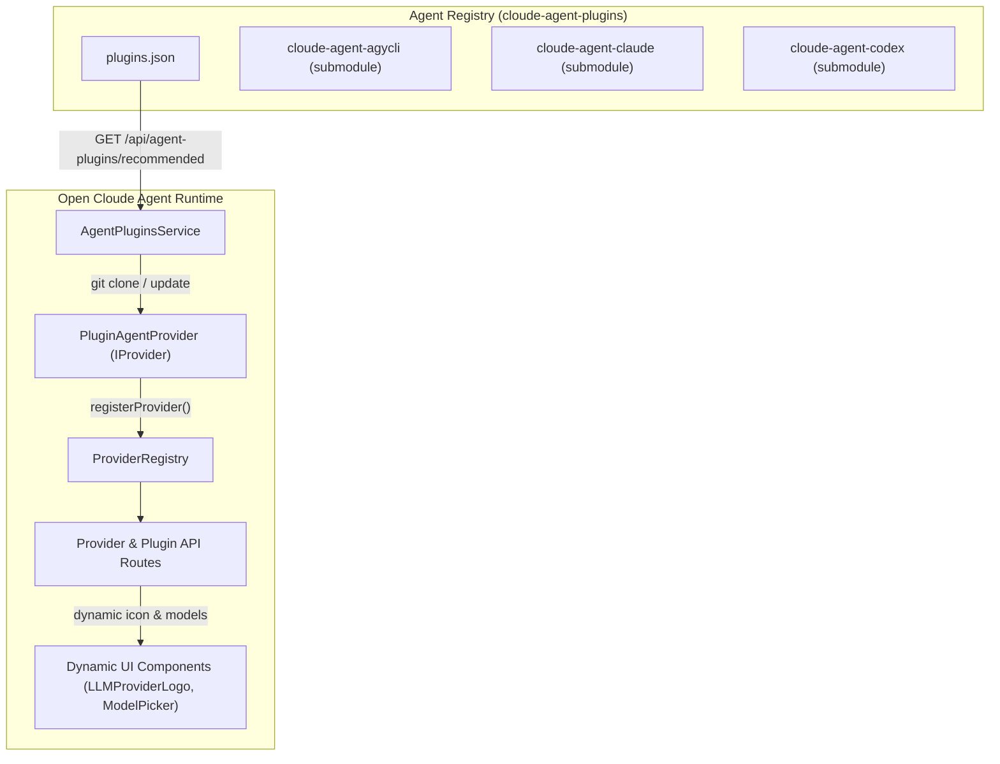

# Agent Plugin Architecture & Standard Specification

*Standards and runtime execution architecture for decoupling Agent plugins from the Open Cloude Agent host.*

This document specifies the architecture, interfaces, and decoupling rules that turn `open-cloude-agent` into a **pure, neutral, high-cohesion, low-coupling Agent plugin execution runtime**. It serves as the authoritative blueprint for creating new Agent plugins as well as extracting existing built-in providers (`claude`, `codex`, `cursor`, `opencode`) into standalone plugins.

---

## 1. Core Philosophy: Neutral Execution Container

In the decoupled architecture:
1. **The Host is 100% Vendor-Neutral**: `open-cloude-agent` contains **no** vendor-specific brand names, hardcoded icon components, proprietary session directory paths, or fallback plugin lists.
2. **Metadata-Driven Runtime**: All provider attributes (display names, CLI binary names, supported model catalogs, session log watch paths, brand icons, authentication commands) are declared exclusively in the plugin's `manifest.json`.
3. **Dynamic Protocol Integration**: Any Agent plugin implementing this standard registers dynamically with the host's `providerRegistry`, instantly participating in the session engine, WebSocket streaming, model selection, and settings management without changing any host code.



---

## 2. Agent Plugin Directory & Manifest Specification

Every Agent plugin is an independent Git repository conforming to the following structure:

```
cloude-agent-<name>/
├── manifest.json       # Authoritative plugin declaration (Required)
├── icon.svg (or .png)  # Plugin square/squircle brand icon (Required)
├── package.json        # NPM package descriptor (Optional/Recommended)
└── README.md           # Documentation (Recommended)
```

### 2.1 Complete `manifest.json` Schema

```json
{
  "name": "cloude-agent-agycli",
  "displayName": "Antigravity CLI",
  "version": "1.0.0",
  "type": "agent",
  "description": "Antigravity CLI (agy) coding agent plugin",
  "author": "RipleyGit",
  "homepage": "https://github.com/RipleyGit/cloude-agent-agycli",
  "agent": {
    "providerId": "agy",
    "cliName": "agy",
    "defaultModel": "gemini-2.5-pro",
    "models": [
      {
        "id": "gemini-2.5-pro",
        "name": "Gemini 2.5 Pro",
        "description": "Google flagship reasoning & coding model",
        "category": "flagship"
      },
      {
        "id": "gemini-2.5-flash",
        "name": "Gemini 2.5 Flash",
        "description": "High-speed coding model",
        "category": "fast"
      }
    ],
    "watchPaths": [
      "~/.gemini/antigravity-cli/brain"
    ],
    "auth": {
      "type": "cli",
      "checkCommand": "agy --version",
      "loginCommand": "agy login"
    }
  }
}
```

### 2.2 Field Definitions

| Field | Type | Required | Description |
| --- | --- | --- | --- |
| `name` | string | Yes | Unique package name (e.g. `cloude-agent-agycli`). |
| `displayName` | string | Yes | User-facing display name (e.g. `Antigravity CLI`). |
| `version` | string | Yes | Semantic version (e.g. `1.0.0`). |
| `type` | string | Yes | Must be `"agent"` to distinguish from generic tool/MCP plugins. |
| `agent.providerId` | string | Yes | Unique runtime identifier (e.g. `agy`, `claude`, `codex`). |
| `agent.cliName` | string | Yes | The executable binary name to invoke or inspect. |
| `agent.defaultModel`| string | No | Default fallback model identifier. |
| `agent.models` | array | Yes | Catalog of models selectable in the UI. |
| `agent.watchPaths` | array | No | Host directory paths to monitor for external session transcripts. |
| `agent.auth` | object | No | Authentication check and login command definitions. |

### 2.3 Brand Icon Asset Rules

1. Place `icon.svg` (vector, preferred) or `icon.png` (high-resolution raster, 256x256 or 512x512) directly at the plugin root.
2. The host serves the icon via `GET /api/providers/:provider/icon`.
3. The UI component `LLMProviderLogo.tsx` resolves dynamic icons using this endpoint with zero hardcoded SVG/PNG assets in the host repository.

---

## 3. Host Decoupling Requirements

Any modification to `open-cloude-agent` must adhere to the following rules:

### Rule 1: No Hardcoded Provider Logos
- **Forbidden**: Adding custom logo components like `AgyLogo.tsx`, `ClaudeLogo.tsx` inside `src/shared/ui/`.
- **Mandatory**: Use `LLMProviderLogo.tsx`. For dynamic providers, it fetches `/api/providers/:provider/icon` and falls back gracefully to a neutral icon (`<Bot />`).

### Rule 2: No Hardcoded Display Names or Provider Switches
- **Forbidden**: `provId === 'agy' ? 'Google AGY' : provId === 'claude' ? ...`
- **Mandatory**: Display names must come from `manifest.displayName` via backend `/api/providers` or `/api/agent-plugins/installed`.

### Rule 3: No Hardcoded Watch Paths in Host Runtime
- **Forbidden**: Hardcoding paths like `~/.gemini/antigravity-cli/brain` or `~/.claude/sessions` in `plugin-agent.provider.ts`.
- **Mandatory**: Watch paths must be parsed dynamically from `manifest.agent.watchPaths`.

### Rule 4: No Hardcoded Default Fallback Plugin Recommendations
- **Forbidden**: Hardcoding plugin GitHub URLs or names in `DEFAULT_RECOMMENDED_PLUGINS` inside `agent-plugins.service.ts` or `InstallAgentModal.tsx`.
- **Mandatory**: Default recommendations must be an empty array `[]`. All recommendations must be loaded dynamically from the registry repository (`https://raw.githubusercontent.com/RipleyGit/cloude-agent-plugins/main/plugins.json`).

---

## 4. Stripping Built-in Providers (Claude, Codex, etc.)

To complete the transformation of `open-cloude-agent` into a 100% pure execution container, built-in providers will be extracted into standalone plugins:

### Step-by-Step Extraction Guide:
1. **Create Plugin Repository**: Create `cloude-agent-claude` and `cloude-agent-codex` under `RipleyGit`.
2. **Move Execution Drivers**: Migrate turn-runner, CLI arguments formatting, and transcript normalization into the plugin repo or wrap them with standard CLI adapters.
3. **Add Manifest & Brand Icons**: Provide `manifest.json`, `icon.svg`, and model catalogs.
4. **Register in Market Registry**: Add submodules and entries to `cloude-agent-plugins/plugins.json`.
5. **Clean Host Built-in Map**: Remove `ClaudeProvider`, `CodexProvider`, etc. from `createBuiltinProviders()` in `server/modules/providers/provider.registry.ts`.
6. **Result**: The host repository becomes completely neutral and agnostic to all Agent brands.
