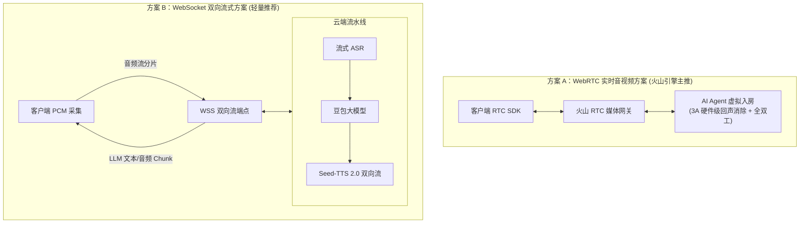
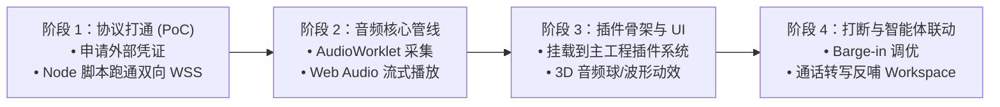

# 豆包实时语音对话集成方案与技术评估

> **文档状态**：调研规划 / 方案设计  
> **创建时间**：2026-11-04  
> **适用项目**：Open Cloude Agent Agent  

---

## 一、 背景与业务目标

当前项目中已具备基于 HTTP 请求的“按键录音转文字（STT）”与“单条消息朗读（TTS）”功能，属于典型的**半双工、单向对讲机式交互**。

本方案旨在评估将字节跳动**豆包（火山引擎）对话式实时语音大模型能力**引入本项目，通过**全双工、低延迟、可随时插话打断（Barge-in）**的拟人化实时语音体验，使开发者在编码、调试或项目规划过程中，能够像与真人专家通电话一样，通过自然语言与智能体协同工作。

同时，考虑到主工程代码稳定性与功能隔离性，本方案对**“核心架构复用性”**与**“基于插件机制（Plugin）落地”**进行深度可行性评估与架构设计。

---

## 二、 豆包（火山引擎）实时语音核心机制

火山引擎面向大模型实时交互提供了两类主流技术路线：



### 1. 核心技术能力
- **毫秒级极低延迟**：首包延迟（TTFA）可压至 **300ms ~ 800ms**，边说边识别、边思考边合成、边生成边播报。
- **随时插话与打断（Barge-in / 双讲优化）**：在 AI 播报过程中，用户一旦开口，系统能在 200ms 内中断当前语音合成与播放，切换到倾听状态。
- **拟人化与情感表现力**：豆包语音大模型（如 `seed-tts-2.0` 及端到端语音大模型）支持笑声、语气词、停顿喘息与特定人设风格，远超传统机械朗读音色。

---

## 三、 现有语音架构复用度评估

经过对当前代码库（`server/modules/voice/` 与 `src/modules/chat/`）的深入分析，现有架构与实时语音的对比如下：

| 架构维度 | 当前项目现有实现 | 豆包实时语音对话要求 | 复用度 | 详细评估与差异分析 |
| :--- | :--- | :--- | :---: | :--- |
| **网络协议** | Express 短连接 HTTP POST (`/api/voice/transcribe`, `/api/voice/tts`) | **持久全双工长连接** (WebSocket 或 WebRTC) | ❌ **无法复用** | 现有的 HTTP 架构无法支撑实时音频流的上行与下行双向持续吞吐，必须引入长连接通道。 |
| **音频录制** | `MediaRecorder` 整段录制为 WebM/MP4 Blob，录完一次性上传 | **流式分块采集**，持续输出 16kHz 16bit 单声道 PCM 分片（约每 40ms 一包） | ⚠️ **部分复用** | [`useVoiceInput.ts`](file:///Users/yubs/Documents/ripleygit.git/open-cloude-agent/src/modules/chat/hooks/useVoiceInput.ts) 中的麦克风权限申请、回声消除（AEC）、降噪（ANS）硬件配置可复用，但底层采集管道必须重写。 |
| **音频播放** | HTML5 `<audio>` 播放器点播完整音频文件 | **流式无缝播放**（Jitter Buffer + PCM 流平滑拼接） | ❌ **无法复用** | `<audio>` 标签必须有完整音频容器头才能解码，无法播放实时到达的裸 PCM 音频切片，必须改用 **Web Audio API (`AudioContext`)**。 |
| **打断机制** | 无打断概念（仅支持手动暂停当前播放） | **双讲检测与实时中断**（前端瞬间静音清空缓冲 + 上游取消指令） | ❌ **必须新建** | 现有架构缺乏打断事件调度机制与静音检测。 |
| **架构思想** | **客户端直连与服务端代理双轨制**，杜绝 SSRF 风险 | 客户端凭证安全隔离与 Token 鉴权 |  **高度复用** | 当前项目中“优先由浏览器直连外部端点、服务端不代持外部网络请求”的安全设计理念在实时语音中依然高度适用。 |

> **评估结论**：现有架构在**“设备授权、降噪参数配置、安全设计思想”**上可以继承约 **25%**，但**“网络传输层与音频渲染管线”**必须采用全新机制实现。

---

## 四、 插件化落地架构设计

为避免在主工程的聊天输入框（ChatComposer）中引入庞大的音视频通信库，建议将实时语音对话封装为**独立插件（Plugin）**。

### 1. 系统总体架构

```
┌────────────────────────────────────────────────────────────────┐
│ 浏览器前端 (Open Cloude Agent)                                     │
│                                                                │
│  ┌──────────────────────────────────────────────────────────┐  │
│  │ 豆包实时语音插件 (Tab 或悬浮浮窗)                        │  │
│  │  • AudioWorklet (麦克风实时采样 16kHz PCM)               │  │
│  │  • Web Audio Context (音频流抖动缓冲与平滑播放)          │  │
│  │  • 3D 音频球动态波形 & 实时字幕瀑布流                   │  │
│  │  • 随时插话打断控制器 (Barge-in Manager)                 │  │
│  └──────────────────────────┬───────────────────────────────┘  │
│                             │                                  │
│                             ▼                                  │
│               WebSocket (/plugin-ws/doubao-voice)              │
└─────────────────────────────┼──────────────────────────────────┘
                              │
┌─────────────────────────────┼──────────────────────────────────┐
│ 服务端代理中继 (Local Server)                                  │
│  • 复用现成 plugin-websocket-proxy.service.ts                 │
│  • 转发至插件专属本地端口 (127.0.0.1:Port)                    │
└─────────────────────────────┼──────────────────────────────────┘
                              │
┌─────────────────────────────┼──────────────────────────────────┐
│ 插件后端守护进程 (Plugin Daemon - Node/Python)                 │
│  • 维护火山引擎鉴权令牌 (AccessKey/SecretKey/Token)           │
│  • 协议编解码与事件状态机管理                                  │
│  • 联动主工程：将关键语音决议通过 pluginHostApi.rpc 写入会话   │
└─────────────────────────────┼──────────────────────────────────┘
                              │
                              ▼ (TLS 加密 WSS 双向流)
┌────────────────────────────────────────────────────────────────┐
│ 火山引擎 / 豆包大模型云端服务                                  │
│  • 实时语音大模型 / 流式 ASR + 豆包 LLM + Seed-TTS 2.0 双向流   │
└────────────────────────────────────────────────────────────────┘
```

### 2. 插件优势分析
1. **免受主工程生命周期干扰**：插件拥有独立的生命周期挂载点（`PluginTabContent.tsx`），通话过程独立于主界面的代码切换。
2. **充分复用项目现有能力**：本项目后端已内置了 [`plugin-websocket-proxy.service.ts`](file:///Users/yubs/Documents/ripleygit.git/open-cloude-agent/server/modules/websocket/services/plugin-websocket-proxy.service.ts)，天然具备通过 `/plugin-ws/:pluginName` 向插件转发 WebSocket 的能力。
3. **双向业务联动（Agent Loop）**：
   - 插件可通过 `pluginHostApi.context` 自动读取用户当前所在的工程路径和选中会话。
   - 语音沟通产生的文字总结或代码修改建议，可通过 `pluginHostApi.rpc` 直接回填到当前会话中。

---

## 五、 需要外部信息的关键清单（商务与依赖准备）

> [!IMPORTANT]
> 以下项目涉及第三方商务合同、账号权限及官方技术规格，需要外部沟通或账号管理员提供：

| 序号 | 类别 | 所需外部信息 / 资源 | 关键说明与用途 |
| :---: | :--- | :--- | :--- |
| **1** | **账号权限** | **火山引擎控制台服务开通** | 需开通：<br>1. 火山方舟（大模型服务）<br>2. 语音技术服务（实时语音识别 ASR、语音合成 TTS）<br>3. 实时语音大模型/对话式 AI 服务权限 |
| **2** | **凭据与鉴权** | **开发者凭证矩阵** | 需获取并配置：<br>• `AppID`<br>• `AccessKey ID` 与 `Secret Access Key`<br>• `Cluster ID`（集群标识）<br>• `Resource ID`（如 `seed-tts-2.0` 或指定模型版本号） |
| **3** | **官方规范** | **WebSocket V3 二进制协议包格式定义** | 火山引擎针对双向流式对话采用特定的二进制协议帧结构，包含：<br>• 协议头 Magic Number 与固定字节序<br>• Header Extensions / Payload Type（JSON 控制帧 vs 二进制音频帧）<br>• Gzip 压缩标识位规范 |
| **4** | **费用评估** | **调用成本与并发限额（Quota）** | 明确商业计费模型：<br>• 按通话时长计费（如 0.xx 元/分钟）还是按 Token 计费<br>• 默认并发连接限制（并发路数），避免本地多标签页测试导致限流封禁 |
| **5** | **音色与人设** | **发音人（Voice Type）定制列表** | 确认业务需要的预设音色 ID（如豆包同款音色、技术解说型、温和助理型等） |

---

## 六、 核心技术突破点与难点评估

> [!CAUTION]
> 以下属于研发过程中的核心攻坚点，需重点评估技术风险与开发工时：

### 突破点 1：浏览器端高性能音频流采集与动态重采样（AudioWorklet）
- **难点描述**：
  浏览器麦克风默认采样率一般为 **44.1kHz** 或 **48kHz** 浮点数据，而豆包语音识别标准要求 **16kHz、16bit 单声道 PCM**。
- **技术风险**：
  如果在主线程中进行音频重采样与 PCM 转码，当智能体执行复杂代码高亮或终端输出时，会导致音频帧掉包、声音卡顿甚至浏览器卡死。
- **突破方案**：
  必须基于 **`AudioWorkletNode`** 将采集与重采样逻辑移至独立的音频渲染子线程执行，以固定 40ms 切片持续发射二进制 PCM 块。

### 突破点 2：流式音频无缝播放与 Jitter Buffer（抗抖动平滑调度）
- **难点描述**：
  云端 TTS 返回的是一小段一小段的 PCM 数据块，网络传输存在微小的延迟抖动。若直接收到一块播放一块，声音会出现持续的爆音、破音、间隙和语速不均匀。
- **技术风险**：
  传统 HTML5 `<audio>` 标签完全无法工作。
- **突破方案**：
  在前端利用 **Web Audio API (`AudioContext`)** 自研微型流式调度器：
  1. 建立微缓冲队列（保持 100ms~200ms 的先发缓冲量）；
  2. 利用 `AudioContext.currentTime` 精度时间戳进行音轨无缝串接（Back-to-back 调度）；
  3. 增加首尾 5ms 的快速线性淡入淡出（Cross-fade），彻底消除直流偏移导致的爆音。

### 突破点 3：全双工随时插话与打断（Barge-in / 双讲抑制）
- **难点描述**：
  实现“像人一样交流”最关键的体验是：**用户说话时，AI 必须立刻闭嘴**。
  难点在于：扬声器播放的声音会被麦克风重新录进去，如果处理不当，会导致 AI 外放的声音把 AI 自己打断（自激回音）。
- **突破方案**：
  1. 麦克风端必须开启浏览器硬件级 `echoCancellation: true`；
  2. 配合云端/前端轻量 VAD（语音端点检测）：一旦检测到用户在 AI 说话期间产生有效语音输入，前端立即执行两项动作：
     - **本地动作**：在 50ms 内调用 `audioContext.suspend()` 并清空未播完的音频缓冲队列；
     - **上行通信**：立即向 WebSocket 发送 `interrupt` / `cancel` 事件，指令云端停止当前 LLM 生成与 TTS 推流。

### 突破点 4：复杂状态机与弱网断线自愈
- **难点描述**：
  实时通话涉及复杂的时序状态：`Idle`（空闲）→ `Connecting`（建联）→ `Listening`（倾听用户）→ `Thinking`（模型思考）→ `Speaking`（播放回答）→ `Interrupted`（被打断）。
- **技术风险**：
  长时间通话过程中易发生 WebSocket 握手超时、网络切换断连或状态死锁（如前端以为在播、云端以为在听）。
- **突破方案**：
  在插件中实现严格的**分层有限状态机（FSM）**，配套心跳保活（Ping/Pong 10s 周期）与幂等 Sequence ID，确保在网络抖动恢复后能自动重连并复位到一致状态。

---

## 七、 实施推进建议路线图（Roadmap）

建议按照 **“协议 PoC 验证 -> 独立插件开发 -> 智能体深度联动”** 的节奏稳步推进：



1. **第一阶段（PoC 纯协议打通，预计 2~3 天）**：
   - 准备好火山引擎凭据；
   - 编写独立的 Node.js / Python 命令行脚本，先跑通“本地麦克风 -> WebSocket -> 豆包实时大模型 -> 本地扬声器输出”，确认延迟与打断效果符合预期。
2. **第二阶段（插件底层通信与音频栈，预计 4~5 天）**：
   - 在本工程创建 `plugins/doubao-voice/`；
   - 实现前端 `AudioWorklet` 重采样及 Web Audio 播放排队队列；
   - 接入工程自带的 `plugin-websocket-proxy`。
3. **第三阶段（交互界面与打断体验调优，预计 3~4 天）**：
   - 实现拟人化动态通话面板（音浪波形、实时状态提示、字幕流）；
   - 精细化调优双讲打断灵敏度，消除误触发与回声。
4. **第四阶段（工作区业务闭环，预计 2~3 天）**：
   - 与主工程上下文打通：支持把当前代码报错或需求以语音形式抛出，通话结束后一键生成总结并提交给 Agent 执行。

---

## 八、 总结

将豆包实时语音对话能力引入本项目在**技术与架构上是完全可行的**。采用**插件化模式**不仅能够保证主工程代码纯洁性与稳定性，还能充分发挥已有插件系统的 WebSocket 代理优势。

项目启动前，建议优先协调推进**第五节中的外部账号与凭据开通**，并组织人力重点攻克**第六节中的流式音频缓冲与随时插话机制**。
